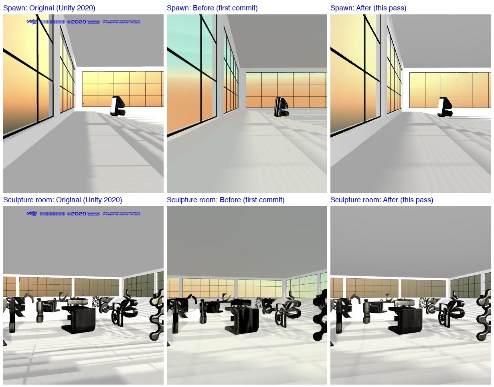

# DISRUPTIVE TYPE [2020 EXHIBITION] — reboot

A rebuild of the 2020 Unity WebGL virtual exhibition in **Vite + TypeScript + three.js**, with
**three-mesh-bvh** for collision. All geometry, textures, UI art, sounds and layout were
extracted from the original Unity build. Nothing was redrawn by hand.

```bash
npm install
npm run dev       # http://localhost:5173
npm run build     # static site in dist/, deploy anywhere
```

## Why the original was slow, and what changed

| | Unity build (2020) | Reboot |
|---|---|---|
| Download | 116 MB gzipped (134 MB data + 14 MB wasm) | ~5.5 MB |
| Sculpture triangles | 2.75 M | 0.55 M (meshoptimizer, visually lossless) |
| Collision triangles | 2.9 M full-res `MeshCollider`s | 150 k (building exact, sculptures simplified) |
| Shadow maps | 3 realtime shadow-casting suns, re-rendered every frame | same 3 suns, rendered **once** (scene is static) |
| Draw calls | ~400 renderers | 7 (geometry merged per material) |
| Menu → room | separate scene load after Start | world preloads while you read the menu |

What's the same: the 1280×800 menu layout, the info screen, all 38 sculpture triggers and their
tag images, the top bar, the crosshair, walk 7 / sprint 10 / jump 8, the spawn point, the
footstep sounds, and the look (white emissive walls, sun-only lighting, brushed-metal sculptures).

What's new: touch controls (left drag = walk, right drag = look, tap = jump), adaptive resolution
(driven by measured GPU time, so a browser's 30 fps cap doesn't blur the room), drag-to-look when the
browser refuses pointer lock, and a pause menu on Esc.

## Faithfulness notes

The look was matched against the running original. Two screenshots of the Unity build were taken
at known camera poses, the same poses were rendered here, and the error was minimised per pixel.
Mean error dropped from 26 / 32 to 10 / 18 levels (spawn / sculpture room):



Things that look odd in the code but reproduce the original on purpose:

- **Gamma colour space.** The Unity project used Gamma, so lighting ran on raw sRGB values. Textures
  and colours are never decoded and the output is never encoded.
- **Square-rooted specular.** Unity's Standard shader does `specularTerm = sqrt(specularTerm)` in
  Gamma space, and uses 0.22 instead of 0.04 dielectric reflectance. That gives the sculptures their
  broad, grey brushed-metal sheen. `BRDF_GGX` is patched to do the same.
- **40-unit shadow distance.** The "High" quality level only drew shadows within 40 units of the
  camera. Distant walls look sunlit while the floor around you sits in the roof's shadow, and it
  shifts as you walk. Shadows fade out by view distance.
- **No environment lighting.** The scene was never baked: the ambient probe is all zeros and the
  reflection probe is black. The sculptures only catch the suns, never the sky.
- **Four "baked" fill lights as spherical harmonics.** Without lightmaps, Unity ran its baked lights
  in realtime. The four dim, upward-pointing ones fell outside the pixel-light budget and went into
  SH, which is what lifts the ceiling and sills above pure emission grey.
- **Walls and ceiling don't block the sun from outside** (`shadowSide = FrontSide`). Unity culls back
  faces in the shadow pass, so the single-sided walls let sunlight through.
- **The sky is an RGBM-encoded HDR cubemap.** It's decoded with the skybox material's tint and
  exposure, plus a curve fitted to the original's on-screen colours.
- **The "Outside" ground plane is invisible.** It used a skybox material, and skybox shaders don't
  write depth, so the real sky painted over it. It's kept as collision only.
- **HUD sizes follow Unity's canvas modes.** The top bar scales with screen width. Tags and the
  crosshair are constant *device* pixels (Unity rendered at device resolution).
- **Grass footsteps indoors.** No collider had a physic material, so FirstPersonAIO always played its
  default (grass) set. Concrete and carpet are shipped too; change `SET` in `src/footsteps.ts`.

## Code map

- `src/world.ts`: renderer, materials (recreated from the Unity Standard shader values), sky,
  lights, collision BVH
- `src/player.ts`: first-person capsule controller (FirstPersonAIO tuning)
- `src/exhibits.ts`: port of `UIAppear`, showing a tag while you stand in a sculpture's trigger box
- `src/footsteps.ts`: stride-based footsteps via Web Audio
- `src/main.ts`: menu flow, input (mouse, keyboard, touch), render loop
- `public/assets/`: generated web assets (committed so the site builds without Python)

## Re-running the extraction

Only needed if the source build changes. Requires Python 3 and Node.

```bash
python3 -m venv .cache/venv && .cache/venv/bin/pip install UnityPy numpy pygltflib Pillow texture2ddecoder

# 1. un-gzip the .unityweb files and split the UnityWebData container
BUILD="path/to/exhibition10/Build"
mkdir -p .cache/raw .cache/unpacked
gzip -dc "$BUILD/exhibition10.data.unityweb" > .cache/raw/exhibition10.data
python3 -I tools/extract/unpack.py .cache/raw/exhibition10.data .cache/unpacked

# 2. scene -> merged glTF + scene.json (player, triggers, lights); textures, UI, audio, cubemap
.cache/venv/bin/python -I tools/extract/export_scene.py  .cache/unpacked/data.unity3d .cache/extract
.cache/venv/bin/python -I tools/extract/export_assets.py .cache/unpacked/data.unity3d .cache/extract

# 3. simplify, compress and convert into public/assets
node tools/build-assets.mjs
```

`tools/extract/tagmap.json` maps each trigger to its tag sprite. It was resolved from the
`UIAppear.customImage` references in the serialized scene data.
